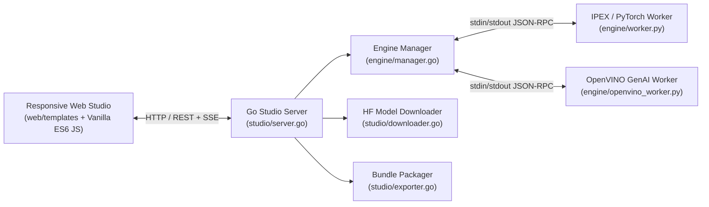

# GO-SD (`go-sd`) — High-Efficiency Local Stable Diffusion Studio & Dual AI Engine

**GO-SD** (`go-sd`) is a lightweight, zero-CGO (`CGO_ENABLED=0`) Go orchestrator and responsive Web Studio for local Stable Diffusion / SDXL image generation, model management, and digital asset packaging.

It pairs an instant-boot **Go HTTP + SSE server** (`<5ms` boot, `0 MB` VRAM on standby) with a **dual headless Python micro-worker architecture** supporting **Intel Arc GPUs (`xpu` via IPEX)**, **OpenVINO GenAI**, **NVIDIA CUDA**, and **CPU** over pure `stdin`/`stdout` JSON-RPC — with no Gradio or heavy WebUI overhead.

---

## Key Capabilities

1. **On-Demand Standby & 100% VRAM Reclamation:**
   - Starts in standby mode with **0 MB VRAM** consumed until you click **Load Model** in the Web Studio.
   - Unloading a model tears down the pipeline, purges allocator caches (`torch.xpu.empty_cache()` / GC), and terminates the worker subprocess for full memory reclamation.
2. **Dual AI Engine Architecture (`ipex` + `openvino`):**
   - **IPEX / PyTorch Worker (`engine/worker.py`):** Supports `.safetensors` SDXL / SD checkpoints on Intel Arc (`xpu`), NVIDIA (`cuda`), and `cpu` with `bfloat16`, VAE tiling, and attention slicing.
   - **OpenVINO GenAI Worker (`engine/openvino_worker.py`):** Native OpenVINO IR model execution for Intel hardware.
3. **Real-Time SSE Progress & Responsive Studio UI:**
   - Live step-by-step generation progress, model load/unload/hot-swap progress bars, collapsible side panels, lightbox inspector, and gallery management.
4. **Built-in HuggingFace Model Hub Search & Downloader:**
   - Search HuggingFace repositories, inspect model files, and download checkpoints directly into `models/` with live progress and cancellation support.
5. **Storefront Bundle Exporter:**
   - Package selected artworks into ready-to-sell ZIP archives with auto-generated cover mockups, commercial license files, tags, descriptions, and Etsy-ready CSV listings (`output/bundles/`).

---

## Architecture Overview



---

## Installation & Distribution

### Option 1: Install via Go (`go install`)
```bash
go install github.com/bkelceoglu/go-sd/cmd@latest
```

### Option 2: Pre-built Binaries (GitHub Releases)
Download the standalone binary for **Linux (`amd64`/`arm64`)**, **macOS (`amd64`/`arm64`)**, or **Windows (`amd64`)** from the [Releases](https://github.com/bkelceoglu/go-sd/releases) page.

### Option 3: Build from Source (`CGO_ENABLED=0`)
```bash
git clone https://github.com/bkelceoglu/go-sd.git
cd go-sd
make build
# Or run full format, vet, unit test, and build pipeline:
make all
# Or cross-compile distribution binaries + SHA256 checksums into dist/:
make dist
```

---

## Quick Start

1. **Place your checkpoint** (`.safetensors` in `models/Stable-diffusion/` or OpenVINO IR in `models/OpenVINO/`) — or download one directly from the Web UI's **Model Manager**.
2. **Ensure your Python worker environment** (`.venv/bin/python` with `torch`/`diffusers`/`ipex` or `/usr/bin/python3` with `openvino-genai`) is available.
3. **Launch GO-SD:**
   ```bash
   ./bin/go-sd -port 8080 -device xpu
   # Or specify custom python/model paths:
   ./bin/go-sd -port 8080 -python .venv/bin/python -model models/Stable-diffusion/your-model.safetensors -device xpu
   ```
4. Open `http://localhost:8080` in your browser.

### CLI Flags
| Flag | Default | Description |
|---|---|---|
| `-port` | `8080` | HTTP server listening port |
| `-python` | `.venv/bin/python` | Path to Python executable (`torch.xpu` / `cuda` / `cpu`) |
| `-model` | `models/Stable-diffusion/juggernautXL_version2.safetensors` | Default SDXL/SD `.safetensors` checkpoint path |
| `-device` | `xpu` | Compute device (`xpu`, `cuda`, `cpu`) |
| `-version` | `false` | Print version and exit |

---

## Project Layout

```text
go-sd/
├── cmd/main.go                # CLI flags, server boot & graceful shutdown
├── engine/
│   ├── manager.go             # Subprocess lifecycle & JSON-RPC SSE bridge
│   ├── types.go               # Engine request/response & progress models
│   ├── worker.py              # Headless Diffusers worker (IPEX XPU / CUDA / CPU)
│   └── openvino_worker.py     # Headless OpenVINO GenAI worker
├── studio/
│   ├── server.go              # HTTP router, REST APIs & SSE handlers
│   ├── downloader.go          # HuggingFace model search & downloader
│   ├── parameters.go          # Style presets & prompt helpers
│   └── exporter.go            # ZIP, cover image, license & CSV packager
├── web/                       # HTML templates & modular Vanilla JS/CSS UI
├── models/                    # Local model checkpoints (ignored by git)
├── output/                    # Generated images & export bundles (ignored by git)
└── Makefile                   # Build, dist cross-compile, test, vet & clean
```

---

## License

Licensed under the [MIT License](LICENSE).
